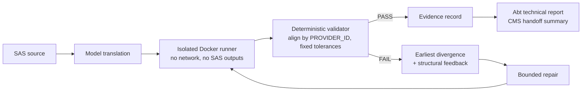

# SASGuard

SASGuard is a verification-guided, AI-assisted system for migrating legacy SAS analytics
pipelines to Python. Built for the Break Through Tech AI Studio Fall 2026 program in
partnership with Abt Global, using the CMS July 2025 Overall Hospital Quality Star Rating
pipeline as the case study.

**Python that runs is not a migration. Python whose outputs match SAS is.** SASGuard treats
the supplied SAS outputs as the answer key. Models translate; ordinary, deterministic software
executes the code in isolation, compares every output against SAS and decides pass or fail.
The model never grades itself.

## Results

| What we checked | Result |
|---|---|
| Full pipeline (Program 0 → 1 → 2), ten SAS output artifacts | **10 of 10 passed** |
| Hospital star ratings (4,566 hospitals, 2,891 rated) | **0 mismatches** |
| Numeric tolerance | 1e-12; stars, counts and categories exact |
| Handoffs between programs | Each stage's input checked exactly against the previous stage's actual output |
| Supplied SAS programs, data and outputs | 29/29 protected files unchanged before and after every run |
| Automated tests | 818 passed, 31 skipped (Docker-gated) |

| Program | Outputs | Code used in the 10/10 run |
|---|---|---|
| 0: data and measure standardization | 3/3 | Human-written reference |
| 1: domain group scores | 5/5 | Human-written reference |
| 2: weighted summary score, FASTCLUS clustering, stars | 2/2 | Reference implementation recorded as *helper-assisted model output*, pending teammate review |

Every run writes an evidence record (source, input, output and policy hashes; environment;
git commit) and the report step re-checks those hashes before it will call anything VERIFIED.
See [Full-pipeline validation](docs/full-pipeline-validation.md).

### What the models did

These experiments translated real SAS source. Prompts contained the SAS programs, input column
names and a runtime contract, and **never** hospital rows, trusted output values or human
Python.

- **Program 0, fixed by its own feedback loop.** `gpt-6-luna` failed its first attempt, then
  passed all three artifacts after two automatic repairs driven only by validator
  diagnostics, with no manual edits
  ([experiment](docs/experiments/2026-11-10-program0-automatic-repair-v2.md)).
- **Program 2, wrong in 2 of 2,891 star ratings, and the validator caught it.** The model's
  best candidate matched every score, weight and peer group but missed two stars. We traced
  the cause to SAS FASTCLUS `STRICT` behavior, confirmed it from SAS documentation, and with
  that one correction the stars matched exactly
  ([baseline](docs/experiments/2026-11-10-program2-luna-baseline.md),
  [STRICT replay](docs/experiments/2026-11-16-program2-strict-replay.md)).
- **Model-generated chain.** A fresh run using the model Program 0, the human Program 1 and
  the corrected model Program 2 also passed all ten artifacts.
- **Local models.** Small local models (Qwen3 4B, Qwen3.5 9B) were evaluated on synthetic SAS
  cases, with and without tested SAS helper functions
  ([comparison](docs/local-model-helper-comparison.md)).

The point is not that a model got it right. The point is that **an executable but wrong
translation cannot pass**, and the report says exactly where it first diverged.

## How it works



- **Isolation:** generated code runs in a network-disabled container that cannot see the
  trusted SAS outputs ([isolated runner](docs/isolated-runner.md)).
- **Validation:** rows aligned by `PROVIDER_ID`, missing values preserved, tolerances fixed
  before any run ([comparison policy](docs/comparison-policy.md)).
- **Diagnosis:** the validator names the earliest failing program, artifact, column and
  row, so repair feedback is specific
  ([full-pipeline validation](docs/full-pipeline-validation.md)).
- **SAS semantics:** tested helpers for the behavior models get wrong, such as FASTCLUS seed
  selection, STRICT distance handling and UNIVARIATE percentile definition 5
  ([FASTCLUS](docs/fastclus-iteration.md)).
- **Honest labels:** each stage records whether its code came from a human, a model, a model
  with helpers or a manually corrected model, and review is recorded separately from origin.
  A report is VERIFIED only when every stage's evidence is present and re-checked.
- **Privacy:** model prompts carry no hospital data; CMS summaries carry no provider IDs or
  unexpected column names.

## Quickstart

Requires Git, Docker Desktop and Python 3.11 or 3.12. No API key or SAS license needed.

```text
git clone https://github.com/Break-Through-Tech/Abt-Global-1A-ai-powered-sas-migration.git
cd Abt-Global-1A-ai-powered-sas-migration
python3.11 -m venv .venv          # Windows: py -3.11 -m venv .venv, and set PYTHONUTF8=1
# Windows: .\.venv\Scripts\Activate.ps1    macOS: source .venv/bin/activate
python -m pip install --require-hashes -r requirements.txt
python -m pip install --no-deps --no-build-isolation -e .
docker compose build

sasguard verify-integrity
sasguard validate-pipeline --run-human-references --run-reference-program2
sasguard report-run reports/runs/pipeline-<UUID>
```

Expected: `Integrity check passed: 29 protected files verified.`, then
`Status: PASS. 10 of 10 artifact comparisons passed.` and `STAR mismatches: 0.` The last
command writes `handoff.md` (CMS summary), `technical.md` (Abt) and `report.json` from the
evidence directory printed by `validate-pipeline`.

`sasguard demo` runs the integrity check, the pipeline and the reports in one step and also
writes a self-contained `report.html`. Both `demo` and `validate-pipeline` take `--config PATH`
for another release's configuration (see [adopting guide, section 3](docs/adopting-sasguard.md#3-using-it-on-a-new-cms-star-rating-release)).

Adopting SASGuard at Abt: see [docs/adopting-sasguard.md](docs/adopting-sasguard.md).

The full demo, including a deliberately wrong result that fails, a partial run, a recorded
repair and both reports, is in the [November demo runbook](docs/demo-runbook.md). Docker-only
setup, Dev Containers and JupyterLab are in [Development setup](docs/development-setup.md).

## Limits

- Validated on the supplied July 2025 release only. `--config` runs the pipeline for another
  release, proven so far on renamed July data; the model workflows and mortality prototype are
  July 2025 only.
- Program 2's bundled reference is pending teammate review; it is labeled helper-assisted
  model output, not human, and its output is not approved CMS ratings.
- FASTCLUS helpers are based on SAS documentation; they have not yet been probed on
  licensed SAS.
- A model-generated Program 1 has not been attempted.
- PASS means the outputs match the supplied SAS artifacts. It is not Abt or CMS approval.

## Documentation

| Topic | Docs |
|---|---|
| Pipeline and results | [Adopting SASGuard at Abt](docs/adopting-sasguard.md), [Full-pipeline validation](docs/full-pipeline-validation.md), [Demo runbook](docs/demo-runbook.md), [Issue close-out](docs/issue-closeout.md) |
| SAS analysis | [Program 0](docs/program-0-analysis.md), [Program 1](docs/program-1-analysis.md), [Program 2 semantics](docs/program-2-sas-semantics.md), [Artifact inventory](docs/artifact-inventory.md) |
| Model workflows | [Program 0](docs/program-0-model-workflow.md), [Program 2](docs/program-2-model-workflow.md), [Prompt preview](docs/program-0-prompt-preview.md), [Model budget (draft)](docs/model-budget-decision.md), [Experiments](docs/experiments/) |
| Verification | [Comparison policy](docs/comparison-policy.md), [Artifact comparison](docs/artifact-comparison.md), [Data integrity](docs/data-integrity.md), [Golden trace](docs/golden-trace.md), [Wrong candidates](docs/program0-wrong-candidates.md) |
| Reproducibility | [Reproducing a run](docs/reproducibility.md), [Run manifests](docs/run-manifests.md), [Isolated runner](docs/isolated-runner.md), [Reports](docs/scoped-run-reports.md) |
| Local models | [Smoke test](docs/local-model-smoke.md), [Comparison](docs/local-model-comparison.md), [Helper comparison](docs/local-model-helper-comparison.md), [Numeric reassessment](docs/local-model-numeric-reassessment.md) |

## Repository structure

```text
.
|-- data/                  Supplied input, SAS source and trusted outputs (protected)
|-- configs/               Protected-artifact manifest and pipeline configuration
|-- src/sasguard/          Package: CLI, runner, validators, SAS semantics, reports
|-- reference_python/      Human-written references and the Program 2 reference
|-- tests/                 Automated tests
|-- docs/                  Analysis, workflows, experiments and runbooks
|-- scripts/               Isolated-runner and replay scripts
|-- notebooks/             Exploratory notebooks
|-- Dockerfile             Development image
|-- Dockerfile.runner      Network-disabled runner for generated code
`-- compose.yaml           Local container workflow
```

## Team

| Name | GitHub | Initial milestone focus |
|---|---|---|
| Tony Mapeke | [@TonyMapeke](https://github.com/TonyMapeke) | Artifact inventory and regression facts |
| Vasco Hinostroza | [@theocsav](https://github.com/theocsav) | Development environment, project structure, and CI |
| Amiri Hayes | [@AmiriHayes](https://github.com/AmiriHayes) | Program 0 analysis and translation prototype |
| Keira Wong | [@keiraw777](https://github.com/keiraw777) | Program 1 analysis and translation prototype |
| Hailey Muñiz | [@haileybella](https://github.com/haileybella) | Program 2 analysis and contributor documentation |
| Loana-Ardi Igabaneza | [@Loaardi](https://github.com/Loaardi) | Data loaders and artifact comparison |

Contributors: read [Contributing](CONTRIBUTING.md) and
[Issues and project board](docs/issues-and-project-board.md), and track work on the
[project board](https://github.com/orgs/Break-Through-Tech/projects/58). Never modify the
supplied artifacts to make a result pass; run `sasguard verify-integrity` before review.

## License

The project license has not yet been selected. The team will confirm an appropriate license
with the Challenge Advisor before publishing one.
